# Home Wrapped

A Tesserae widget: your home's year as Wrapped-style story slides, painted by GPT Image from what Home Assistant already knows. Nothing to set up but Home Assistant Core and an AI key.

| Intro | Big number | Top five | Leaderboard | Personality | Summary |
|---|---|---|---|---|---|
| 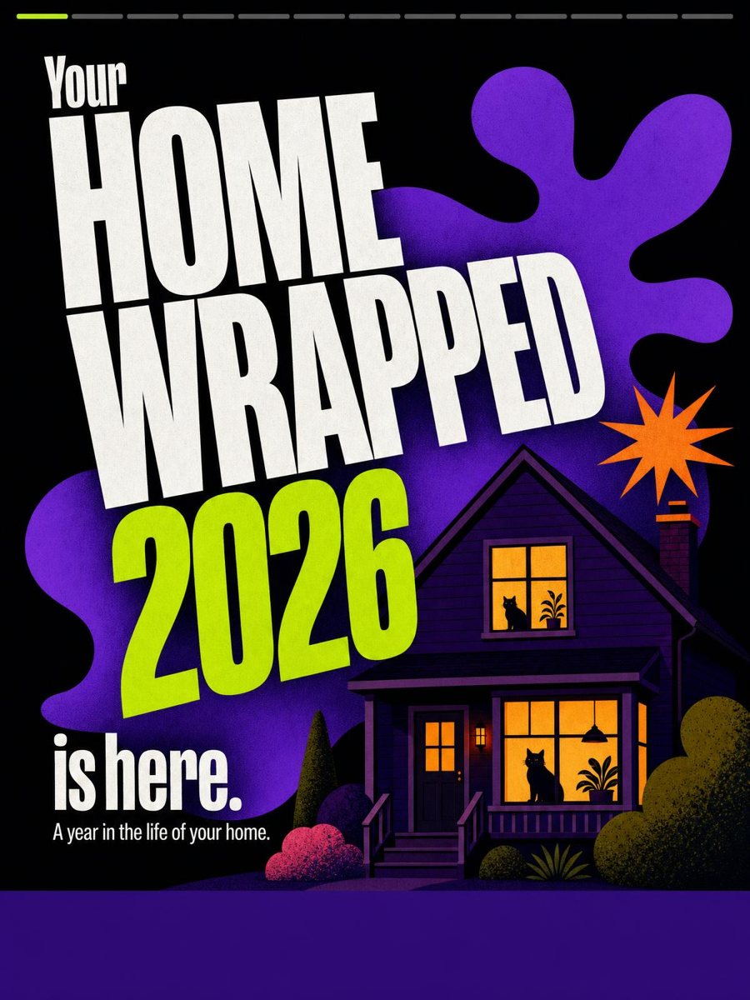 | 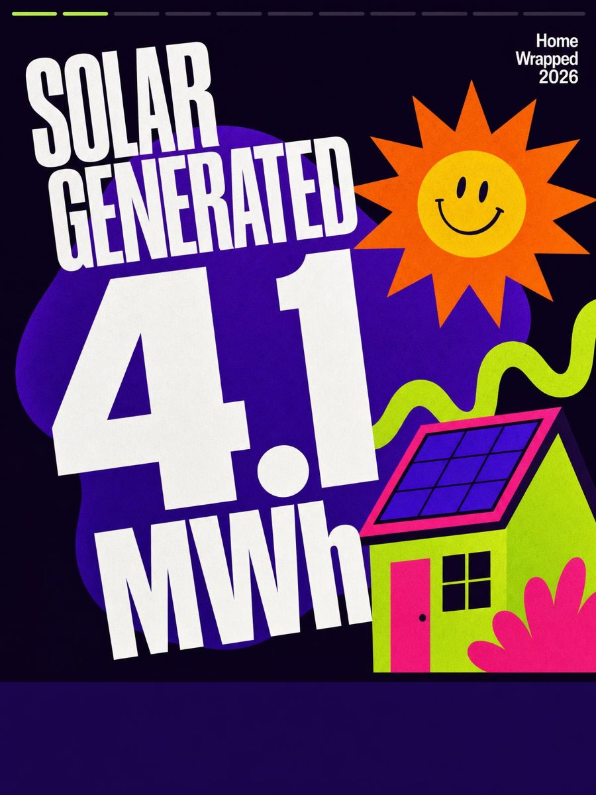 | 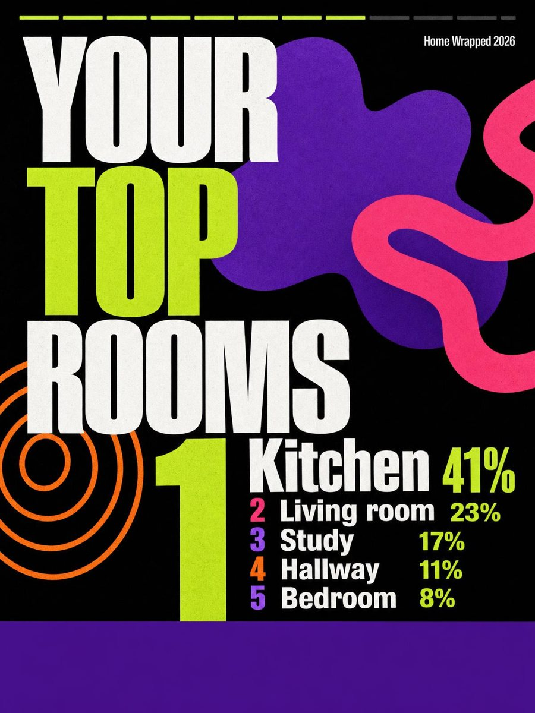 | 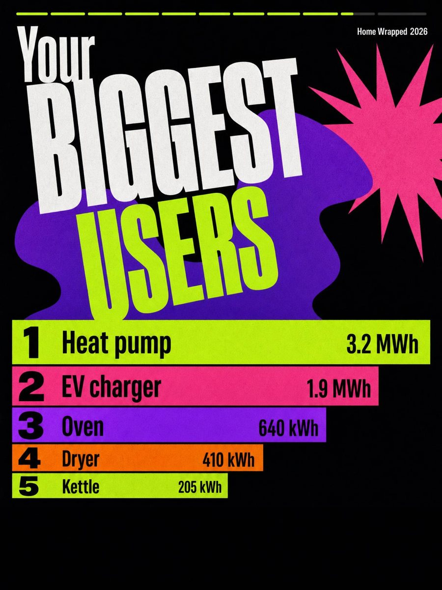 | 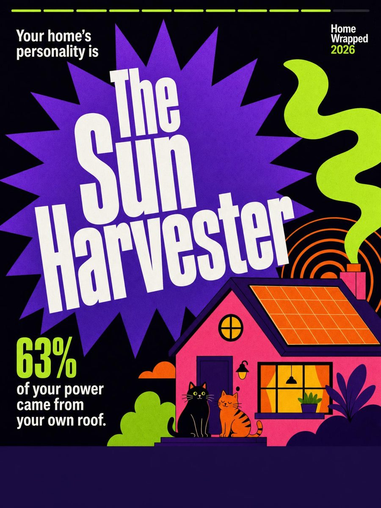 | 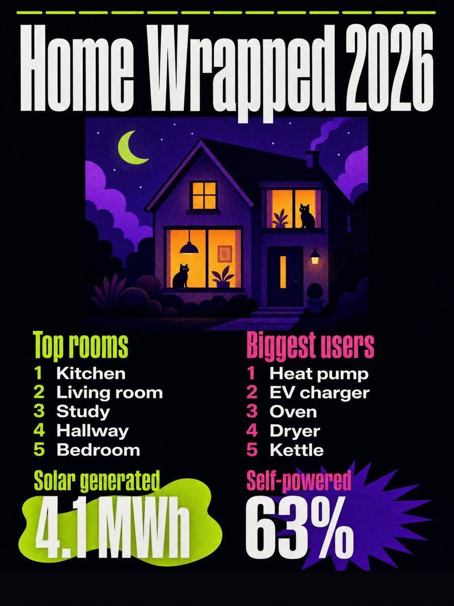 |

| Spectra | | | Greyscale | | Landscape |
|---|---|---|---|---|---|
| 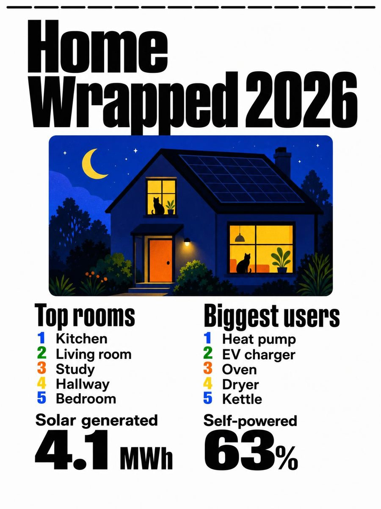 | 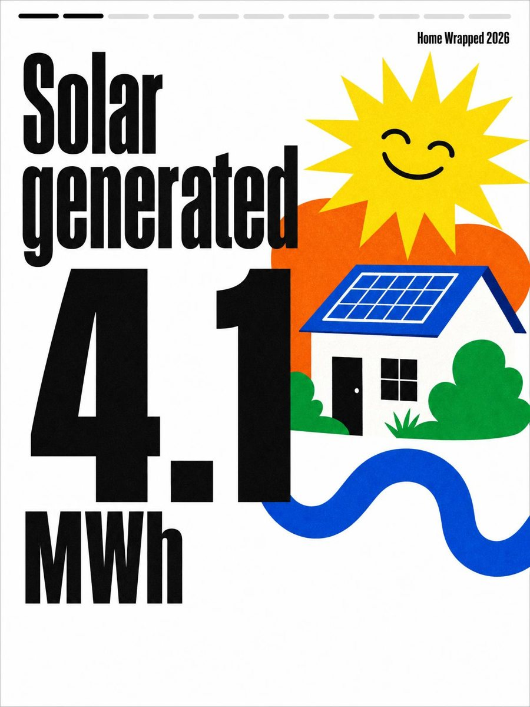 | 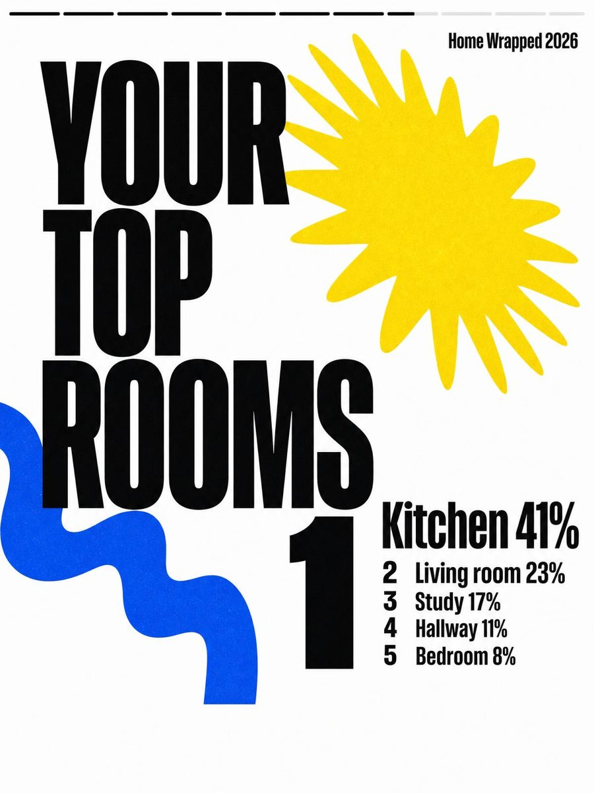 | 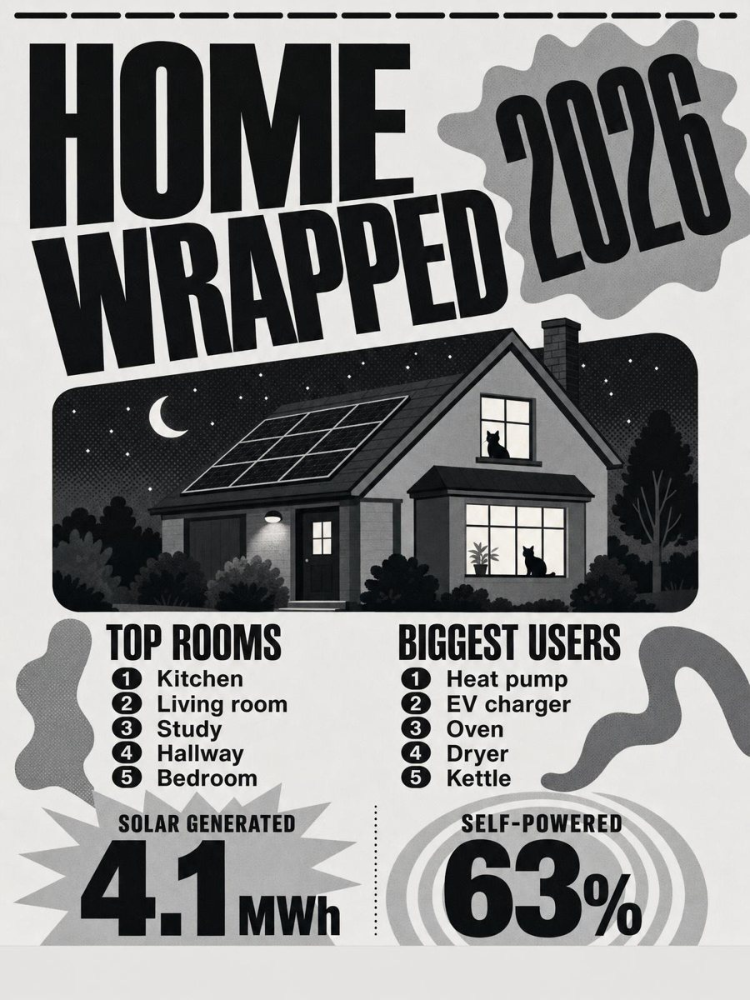 | 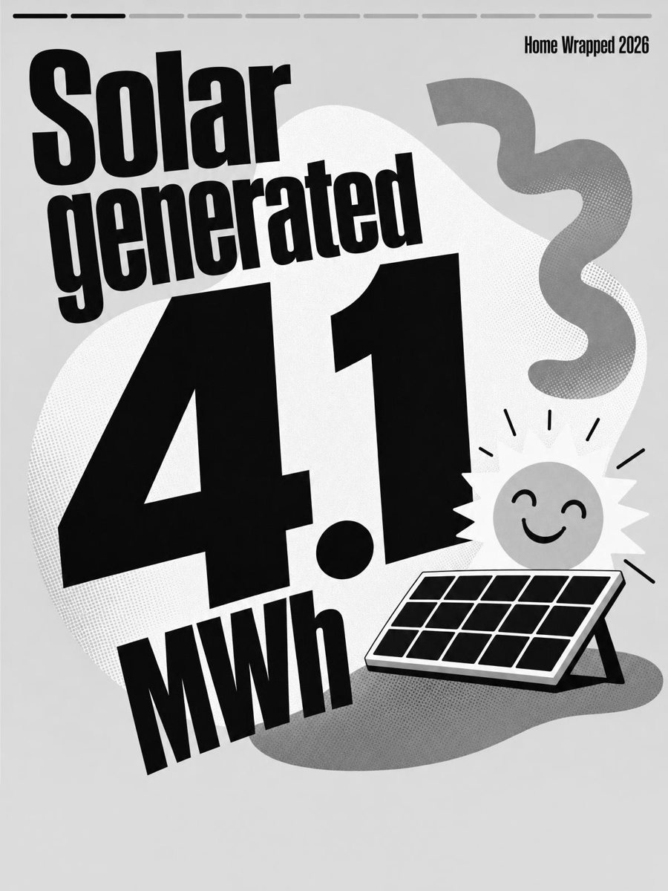 | 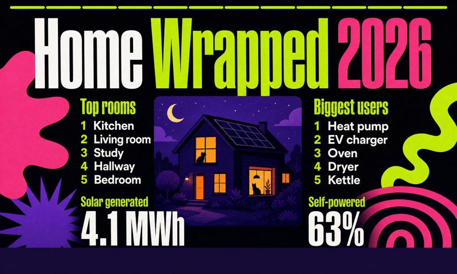 |

The screenshots are the bundled sample slides, painted from a made-up year.

## What it finds

- **Energy, the whole year,** from Home Assistant's long-term statistics, using whatever the Energy dashboard is set up with: solar generated, how much of your power was your own, grid import and export, gas and water, the sunniest months and the biggest individual devices.
- **Climate, the whole year,** from long-term statistics: every temperature sensor placed in its room through the area registry, for the warmest rooms and the hottest and coldest days.
- **Life at home,** from recorder history: door openings, hours of light, hours of telly, days nobody was home and the busiest rooms (motion and occupancy sensors, by area). Home Assistant keeps ten days of history by default, so the widget keeps its own daily ledger from the day it is installed, backfilled with whatever history Home Assistant still has. Until the ledger reaches back to 1 January those slides say "since" the day it starts.

Whatever exists becomes the story: an intro, a big number for each of up to six findings, a top five, a leaderboard, your home's personality (picked by rules from the numbers: The Sun Harvester, The Globetrotter, Grand Central, The Couch Captain, The Homebody) and the summary to share.

## Painting

GPT Image paints each slide whole, words and numbers included, from the real figures, at the cell's own shape (1200x1600 on a 13.3" or OpenPaper L panel). A slide is repainted every week or month, and straight away when you change the title, palette, home or pets, at about 20 US cents a slide. The last good painting stays up while the next one paints, and the figures each slide was painted from can be printed along its foot, so a number the painter got wrong is easy to spot (Repaint it from the widget's paintings page, Widgets › Home Wrapped).

Options: which **slide** (or the whole story, a new slide each hour), the **palette** (Wrapped neon on black, Spectra for a colour e-paper panel's own inks, or greyscale), **your home** and **your pets** for the pictures, and the repaint cadence.

The key is the widget's own fal.ai key, or the one under Settings › Generative AI (fal.ai, or OpenAI for GPT Image). The daily budget defaults to US$2. Until the first slide is painted, without a key, or before Home Assistant has anything to say, the bundled sample slides show with a note saying so.

## The admin sheet

Under Widgets › Admin pages › Home Wrapped: every slide painted for your panels, current or from an earlier week, each with the figures it was painted from, when and in what palette. **Repaint** paints it again from the same figures, for a slide the painter got wrong; **Today's figures** reads Home Assistant again and paints it with the latest; earlier versions are kept and can be put back. Below the slides, what Home Assistant gave: every number and list the widget found, how far back the history ledger reaches, and anything it could not read. **Read Home Assistant again** refreshes it.

## Install

From the Tesserae catalog, or copy this folder into your plugins folder as `home_wrapped`. Needs Tesserae 0.502 or later and the Home Assistant Core plugin. The token needs to be an administrator's: the Energy setup and the registries are only on the websocket API for admins.

## Development

```sh
PYTHONPATH=../tesserae python -m pytest tests -q    # offline: a fake Home Assistant and a fake painter
```

## Licence

AGPL-3.0-or-later. Inter Tight is bundled under the SIL Open Font License (`static/fonts/`). The sample slides were painted by GPT Image.
