# Home Wrapped

A Tesserae widget: your home's year so far as year-in-review cards, from Home Assistant. A summary, big numbers, top fives, a leaderboard and a trading card, in Home, Energy and Pets themes and four palettes, drawn live or painted whole by GPT Image.

| Summary | Big number | Top five | Leaderboard | Trading card |
|---|---|---|---|---|
| 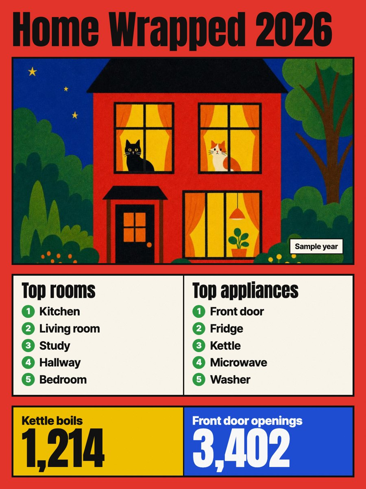 | 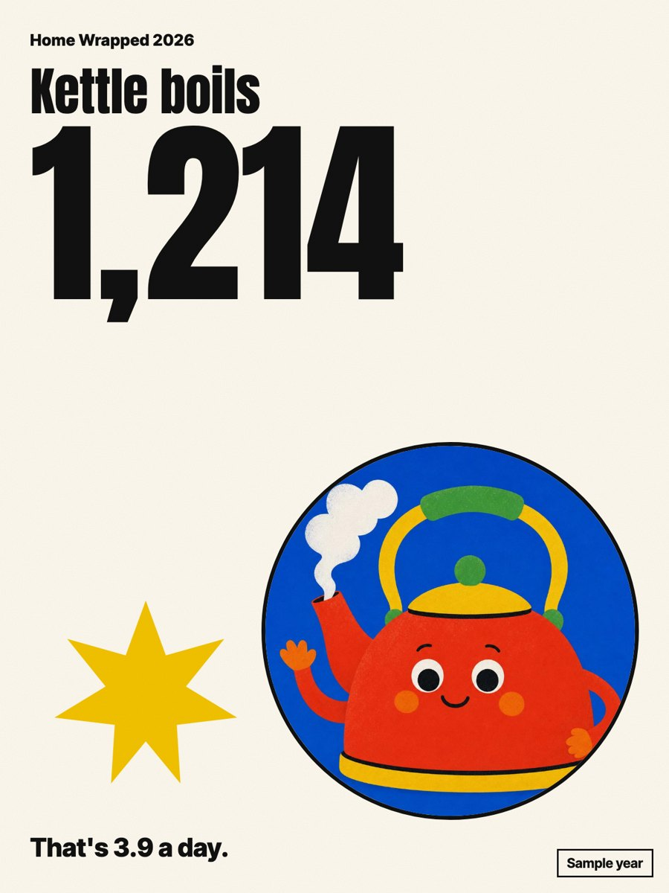 | 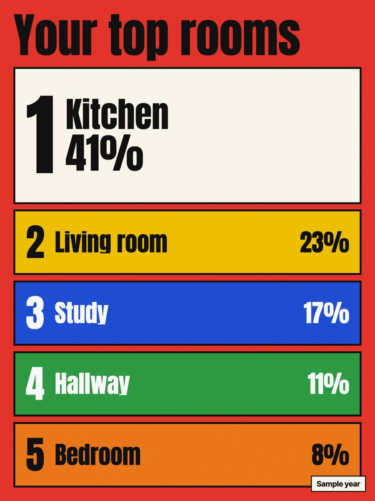 | 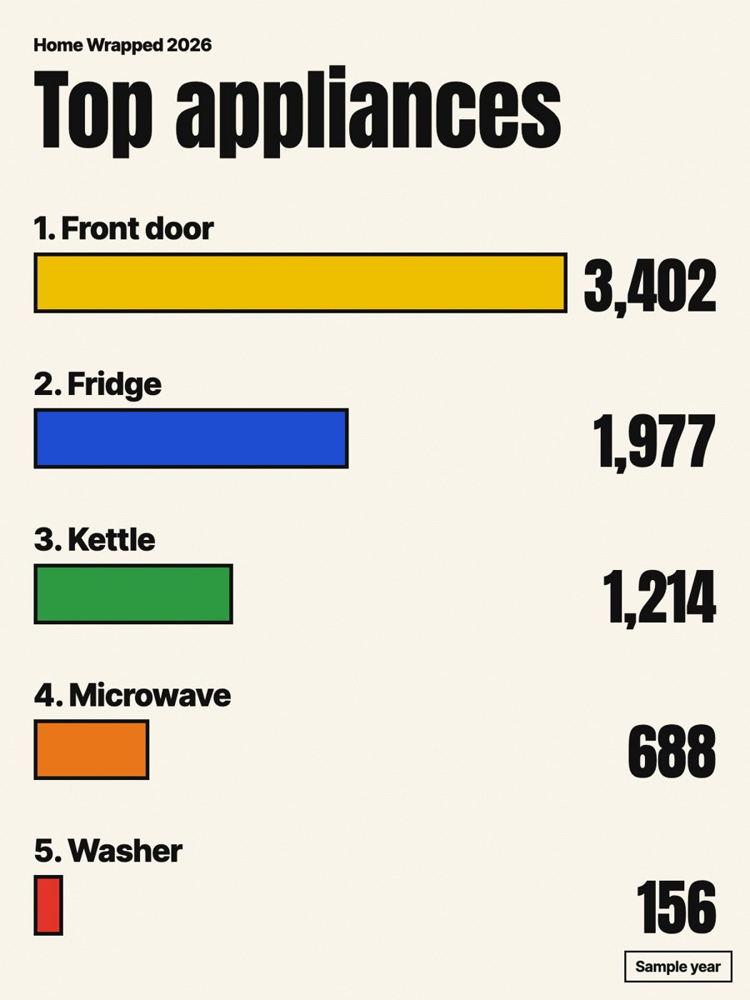 | 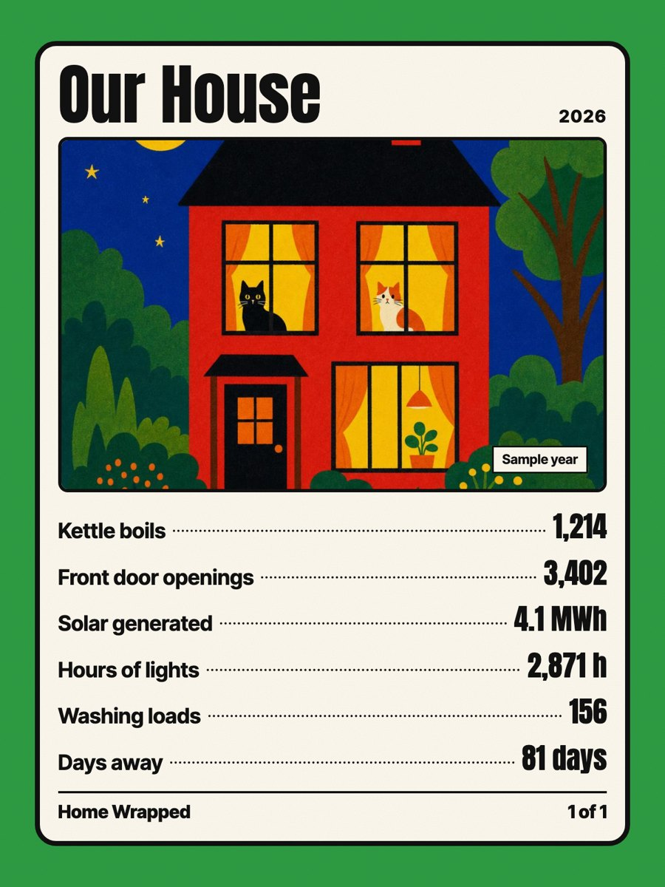 |

| Energy, sunset | Pets, sea | Greyscale | Landscape |
|---|---|---|---|
| 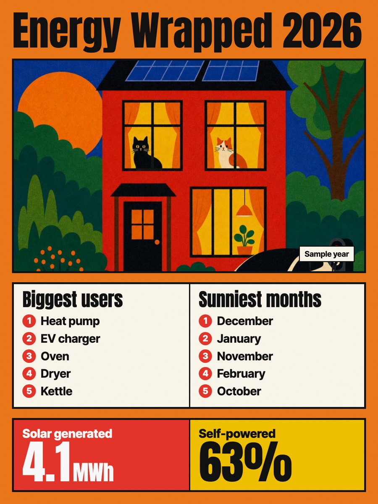 | 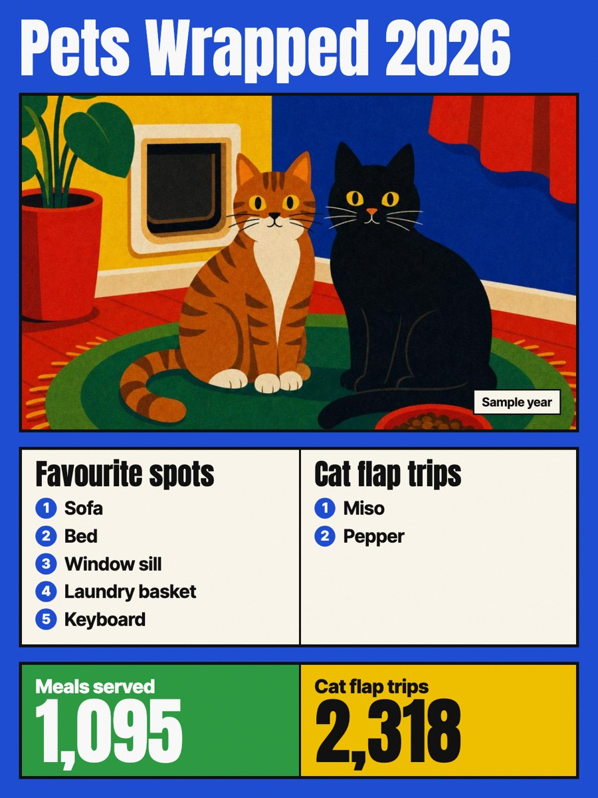 | 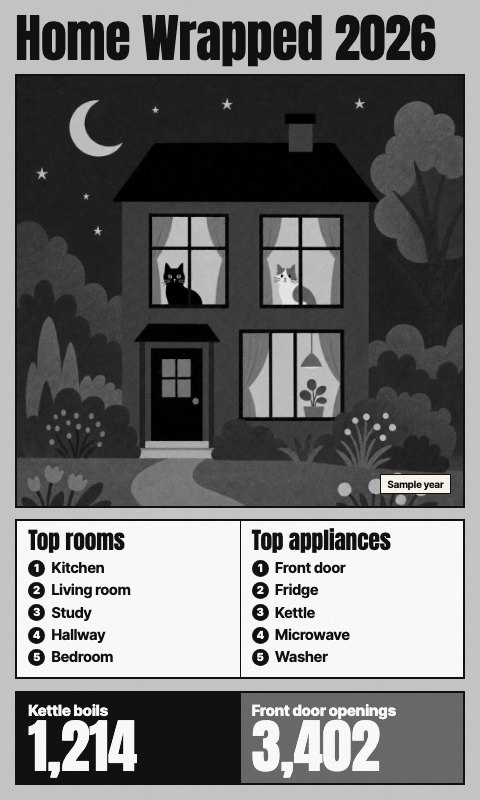 | 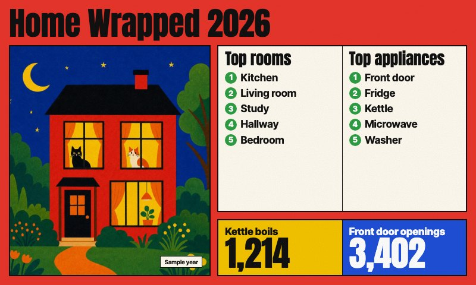 |

Painted by GPT Image, with the figures it was given along the foot:

| | | | |
|---|---|---|---|
| 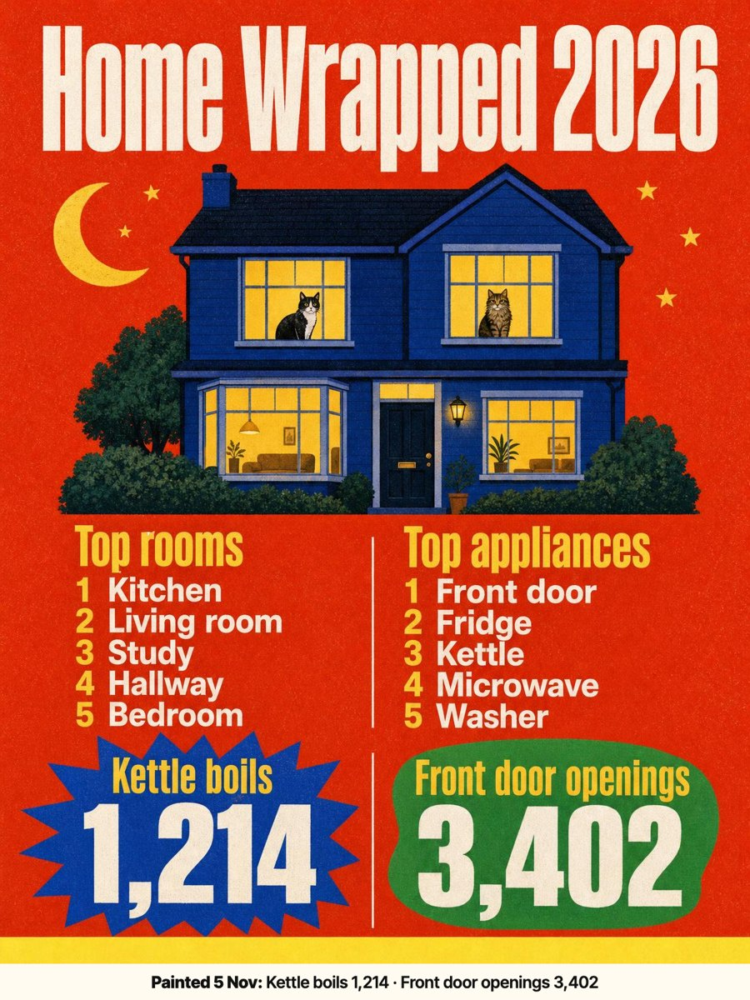 | 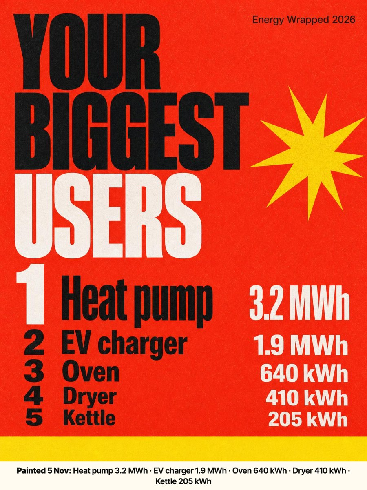 | 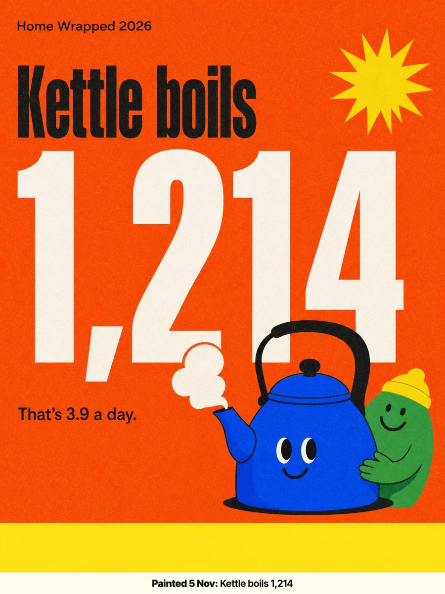 | 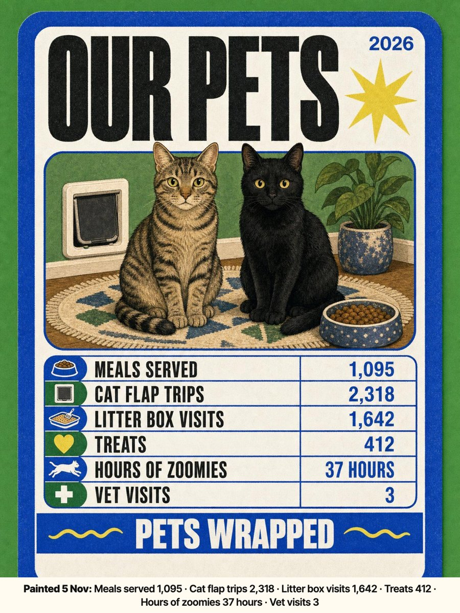 |

All screenshots show the sample year.

## Two ways to render

- **Live** (the default). The widget sets every word and number itself, so they are exact and current on every refresh. The pictures (your house, your pets, one object for each stat) are painted by GPT Image once and kept. The sample year's pictures come bundled, so Live needs no key; with one, the pictures are repainted for your own home and pets, and in another palette.
- **Painted.** GPT Image paints the whole card, words and numbers included, from your real figures, in the look of the screenshots above. A card is repainted every week or month (your choice), and straight away when you change a heading, a stat, the home, the pets, the theme or the palette, at about 20 US cents a card each time. The last good painting stays up while the next one paints. The figures each card was painted from are printed along its foot, so a number the painter got wrong is easy to spot; Repaint it from the widget's paintings page. Until the first painting is ready, without a key, or for the sample year, the card is drawn live.

The key is the widget's own fal.ai key, or the one under Settings › Generative AI (fal.ai, or OpenAI for GPT Image). The daily budget defaults to US$2.

## Cards

- **Summary**: the picture, both top-five lists and the first two stats.
- **Big number**: one stat, its picture and, for a plain tally, "That's 3.3 a day". **Which stat** picks it.
- **Top five**: the first list, ranked, each with its share.
- **Leaderboard**: the second list as bars.
- **Trading card**: every stat on a collectible card.
- **Cycle**: a new card each hour, through the summary, the top five, every stat, the leaderboard and the trading card.

Palettes: primary, sunset and sea sit close to a Spectra 6 panel's own inks; greyscale is for black-and-white panels.

## Setting up the numbers in Home Assistant

Each stat and list row is one line, `Name = entity`, whose entity already holds the year so far and resets on 1 January. Nothing depends on how long Home Assistant keeps history (ten days by default).

**Counts** (kettle boils, door openings, washing loads): a Counter helper, bumped by an automation and reset each new year.

```yaml
counter:
  kettle_boils_year:
    name: Kettle boils this year

automation:
  - alias: Count a kettle boil
    triggers:
      - trigger: numeric_state
        entity_id: sensor.kettle_plug_power
        above: 1500
        for: "00:00:20"
    actions:
      - action: counter.increment
        target: { entity_id: counter.kettle_boils_year }
  - alias: Reset the year's counters
    triggers:
      - trigger: time
        at: "00:00:00"
    conditions:
      - condition: template
        value_template: "{{ now().month == 1 and now().day == 1 }}"
    actions:
      - action: counter.reset
        target: { entity_id: counter.kettle_boils_year }
```

**Energy and time** (solar, hours of lights, time in each room): a Utility Meter helper with a **yearly** cycle. For energy, point it at the energy sensor. For time, first make a History Stats sensor that measures today, then a yearly Utility Meter over it with *Periodically resetting* switched on.

```yaml
sensor:
  - platform: history_stats
    name: Kitchen occupied today
    entity_id: binary_sensor.kitchen_presence
    state: "on"
    type: time
    start: "{{ today_at() }}"
    end: "{{ now() }}"

utility_meter:
  kitchen_hours_year:
    source: sensor.kitchen_occupied_today
    cycle: yearly
    periodically_resetting: true
```

Then in the widget:

```
Stats:
Kettle boils = counter.kettle_boils_year
Solar generated = sensor.solar_energy_year

First list (Top rooms):
Kitchen = sensor.kitchen_hours_year
Living room = sensor.lounge_hours_year
```

Units are read from each entity: kWh rolls up to MWh, minutes and seconds to hours; `%` and days are kept.

## Install

From the Tesserae catalog, or copy this folder into your plugins folder as `home_wrapped`. Needs Tesserae 0.463 or later and the Home Assistant Core plugin. Painted cards at full size need Tesserae 0.502 or later; an older one paints them smaller.

## Development

```sh
PYTHONPATH=../tesserae python -m pytest tests -q    # offline: Home Assistant and the painter are faked
```

## Licence

AGPL-3.0-or-later. Anton and Inter Tight are bundled under the SIL Open Font License (`static/fonts/`). The bundled pictures were made with GPT Image.
